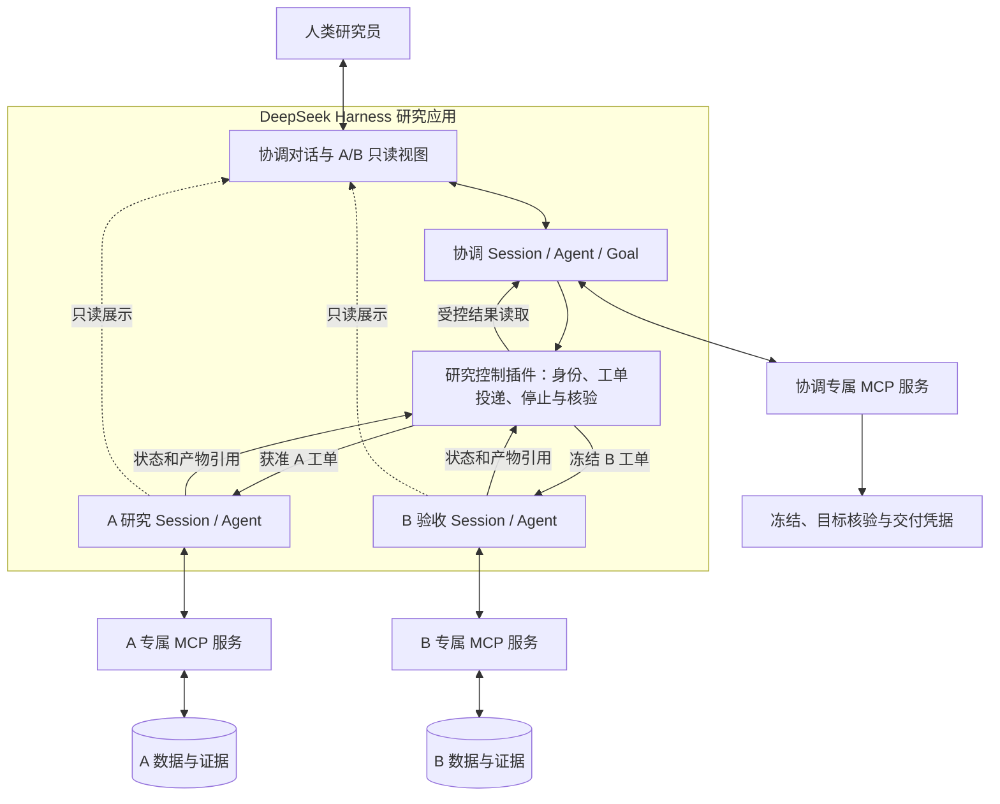

# 因子挖掘 DeepSeek Harness 三会话实施 Plan

首次记录：2026-10-13；本版修订：2026-10-18（北京时间）。<br>
状态：本轮适用P0—P5本地合成工程交付与验收完成。固定DSH 0.2.1-rc.2、bundle0.3.0，正反B与Goal门禁、A自主修改、合同版本变更、真实数值取消、原生摘要冷重启、全入口隔离及安装/卸载/激活失败均有证据。修复后postfix同运行保留原3个Session/Goal，完成A→冻结→唯一B→完整交付与目标核验，Goal最终complete revision7、研究stopped；累计320/320次。预算调整、重启恢复和最后Goal完成状态指令经人类明确授权，不将该运行记为完全无人介入成功率样本。详见[最终交付报告](../reports/DSH本地工程交付与验收_20261018.md)。P6/R1—R3和真实行情未执行。

本版依据用户“全部基于 DeepSeek Harness，而不是 Codex”的决定，替代原《因子挖掘 Codex 原生三会话实施 Plan》。新系统的界面、Session、Agent 循环、模型接入、Goal 和消息调度均由 DSH 及项目插件承载；不依赖 Codex App、Codex SDK、Codex 原生 Goal 或聊天工具。

以下两段保留同日早期阶段的历史状态；当前最终结论见本页顶部与第11.5节。

**2026-10-18 本轮补充：** 固定三会话的真实 Web 可打开、协调唯一输入/A-B 只读、运行中 UI Stop、停止状态跨 Host/MCP 重启保存及原 Goal 显式恢复子路径已通过。恢复后 A 完成唯一候选解释、决定与封存，保留数 0，按合同跳过冻结/B；领域 Goal 为 `incomplete`，native Goal 为 `paused`，最终研究运行 `stopped`。预算 44/48（含失败和中断）；Node 27/27、Python 20 passed。P3/P4/P5 全阶段保持未验收；具体证据、失败历史与缺口见[本轮报告](../reports/因子挖掘DSH停止恢复验收_20261018.md)。

**同日下一阶段：** 协调 A 结果的有界完整读取、原生事件等待、一次回执通知及自主零保留结项已通过独立合成运行。一条人类启动后自动完成收取，无操作者粘贴 A 结果；结项后另一次进度提问引用证据且保持暂停。预算 23/32，Node 32/32、相关 Python 25 passed；1 项既有 B 恢复夹具缺少 Agent 列表接口的失败已在修改前快照复现，未当作通过。研究运行 stopped，领域 Goal incomplete，native Goal paused。见[协调自主收取报告](../reports/因子挖掘DSH协调自主收取验收_20261018.md)与第 11.4 节；不完成 P3/P4/P5 全阶段。

同日已经确认的研究与交互决定继续生效：A 配对修改采用“均值达标 + 改善置信区间下界大于零”（第 7.2 节）；协调是人类唯一对话和调整入口；A/B 只读观察；通过程序任务工单提供精简环境说明 Thin Spec。以上尚未实施部分与 DSH 一并验收，不因重写 Plan 标为完成。

## 1. 目标与执行范围

用户在基于 DSH 的研究界面中使用三个可见、可持续的会话：**研究协调、A 阶段完整研究、B 阶段验收**。协调承担人类对话、目标推进与交付复盘；A 自主取证、构想、实验、解释和优化；B 接收冻结批次，调用程序验证并解释结果。Python 只提供研究合同、计算、记录与验收。

- 在 `/Users/stellan/factor-mining` 实施；旧“量化投资”目录仅作来源参考。保护已有用户改动，按实际差异验收。
- 本轮已获授权实现计划及必要文档与验收；保留已有用户改动，不推送、发布或部署，不使用真实行情。DSH 调用只用于合成验收，并受项目级有限请求预算约束。
- 后续实施以 DSH Web 作为首个可验收界面，复用其会话展示；研究插件提供协调输入和 A/B 只读视图。首期不另做桌面打包或独立前端框架。
- 三个研究 Agent 均由 DSH 调用其配置的模型供应商；不通过 Codex 子进程、聊天桥接或 SDK 隐藏执行研究。采用 DSH 不自动决定模型品牌、名称或费用。
- 用户本次交接指定 GPT-6.1 Sol high 接手实现，原 Luna 对话停止且不恢复；这是开发分工，不是产品运行依赖。本轮研究模型保持已配置的 DeepSeek Flash high，未因接手而改变。
- 复用 DSH 循环和生命周期；项目插件只补身份绑定、受控消息、研究入口、停止联动及证据核验，不另写 Python 自动选题循环或第二套模型调度器。
- 旧四角色、旧 `GoalRunner` 和旧模型适配保留供历史读取与明确指定的对照；新安装与运行路径不依赖它们，不自动恢复旧 Goal 或转换旧证据。
- 后续按已获授权连续完成代码和本地验证。部署、发布、推送、正式数据及批量付费实验沿用各自授权范围；本 Plan 不扩大授权。

## 2. 实施基线与复用范围

截至本版修订，仓库已有多项未提交修改。旧版“尚无 MCP 服务/动作接口”的描述已过时；以下按实际文件和历史报告区分已有能力与待做工作。

| 已有能力 | 现有落点 | DSH 路线安排 |
| --- | --- | --- |
| 纯程序研究动作、角色工具表 | `research_actions.py`、`research_tools.py` | 复用；模型仅由 DSH 执行 |
| 固定角色 MCP 服务 | `mcp_server.py` | 复用官方 MCP SDK 与 STDIO 传输；由 DSH 分角色挂载 |
| 运行绑定、工单雏形 | `native_chats.py` | 保留领域部分，新增 DSH 绑定；不把旧 thread ID 伪装成 Session ID |
| 动作回执、互斥与恢复 | `action_ledger.py`、`records.py`、`factor_archive.py` | 复用；消息交接回执与领域 action_id 分开 |
| 公式执行、多期限与配对检验 | `factor_expressions.py`、`evaluation.py` | 复用；实施第 7.2 节新规则并保留历史合同语义 |
| A 封存、冻结、B 检查点与交付 | `research_actions.py`、`workflow.py` | 保留单向 A→B 及单次访问合同 |
| 数量/质量目标证据核验 | `goal_evidence.py` | 作为 DSH 研究 Goal 完成的必要依据 |
| 旧角色与模型路由 | `agent_*.py`、`goal.py`、`codex_model.py` 等 | 仅旧路径；新入口不得间接调用 |
| Python 依赖 | `pyproject.toml`、`uv.lock` | `openai-codex`为旧路径可选依赖；独立无Codex SDK环境已完成DSH内核导入与安装生命周期验证 |

[2026-10-15 核验报告](../reports/因子挖掘原生三会话P2-P5实施核验_20261015.md)记录了领域程序与本地 MCP 合成链路通过，不代表 DSH 或原生 App 的完整研究验收。既有 Codex 聊天预检只保留为历史证据，不作为 DSH 身份、隔离、预算或恢复通过的依据。

## 3. 目标架构与职责



### 3.1 三个持续会话

| 会话 | 职责与决定 | 禁止越过的边界 |
| --- | --- | --- |
| 协调 | 需求对齐、固定目标与合同、记录人类变更、受控派发、进度解释、必要求助、验收与复盘 | 不代 A 决定具体候选，不把 B 反馈转为同批次 A 的研究指令 |
| A | 按 A 证据自主构想、补读、预声明实验、公式修复、解释、保留/优化/暂停/淘汰并封存 | 不读 B/C，不改程序准入，不在封存后继续写入，不接收人类直发 |
| B | 接收冻结批次，调用一次数值验证，解释已存结果，形成报告和卡片 | 不改公式/方向/期限，不扩大币池，不反复访问 B，不接收人类直发 |

A 不再强制串联四个旧 prompt；根据证据自主选择下一动作。B 始终保持独立会话。首版只有这三个主要 Agent，额外角色只在第 10 节受控实验中创建。

### 3.2 DSH 能力与项目插件分工

依据官方[架构文档](https://github.com/deepseek-ai/deepseek-harness/blob/master/docs/architecture.md)、[Agent 接口](https://github.com/deepseek-ai/deepseek-harness/blob/master/docs/subsystems/core.md)和[MCP 文档](https://github.com/deepseek-ai/deepseek-harness/blob/master/docs/subsystems/mcp.md)，DSH 提供 Session、Agent 创建/恢复、作用域工具、输入与工具执行扩展点。以下为项目组合设计，准确 API 及配置须在选定版本验证。

| 层 | 使用方式 | 项目负责的部分 |
| --- | --- | --- |
| DSH 运行时 | 复用标准 Agent loop、模型适配、持久化 Session 和可用的上下文压缩能力 | 固定版本和配置，验证长上下文接续与日志可追溯 |
| DSH Web | 复用会话事件及展示机制 | 协调唯一输入、A/B 可打开只读查看，服务端阻止绕过 |
| 研究控制插件 | 以 DSH 当前真实 Agent/Session 身份绑定研究角色 | 验证工单、受控投递、阶段限制、等待/收取、停止和总目标完成门槛 |
| 角色 MCP 连接 | 各角色在自己的作用域配置一个固定角色服务 | 可信宿主连接绑定研究 ID、角色及输入，不接受模型自报身份 |
| Python 领域内核 | 显式动作、计算、归档、冻结、检查点和核验 | 所有研究合同及数值事实；不调用模型或向会话发送消息 |

不直接启用默认 Agent Teams 作为生产通信通路。官方 Teams 允许成员互发消息、共享工作目录，且仍属实验功能；其默认合同不能满足本项目单向信息边界。使用 DSH 独立 Session 和项目受控投递，不额外建立共享任务板。[Teams 合同](https://github.com/deepseek-ai/deepseek-harness/blob/master/packages/experimental/agent-team/README.md)

### 3.3 版本、模型与安装

实施 P0 时选定一个可复现的 DSH 发布版本或提交，固定配套插件、Node/包管理器和依赖锁；运行中不自动升级。官方当前标明开发预览并可能破坏兼容，不能把搜索时的 master 文档当作固定版本测试结果。[官方仓库](https://github.com/deepseek-ai/deepseek-harness)

项目专用 profile 只加载研究所需能力，不继承个人通用 Agent 的全部工具、记忆和插件。模型通过 DSH 原生供应商适配调用，记录实际 provider、模型版本、支持的推理设置与计费来源；不沿用 Codex 内部模型别名、登录态、Fast 标记或订阅额度假设。必要模型/预算信息缺失时，先完成不依赖模型调用的工程工作。

新路径须在未安装 Codex SDK、无 Codex 配置及登录态的环境中完成安装、导入和合成链路。旧适配按实际入口移至可选依赖及按需导入，保留其历史使用合同；本次不据此清理其他无关依赖。

### 3.4 官方插件交付与 profile 装配

按官方[插件打包与安装规范](https://github.com/deepseek-ai/deepseek-harness/blob/master/docs/user/develop/basic/publish.md)区分两个对象：**bundle 是项目交付的可安装配置层及插件代码，profile 是用户启动的运行组合**。首期交付一个研究 bundle，包含研究控制 Host 插件和必要 Web Client 扩展；不按协调/A/B 拆成三个插件包。

- 仓库 `harness/` 保存 bundle 源码、构建配置、配置补丁和依赖锁。bundle 的 `package.json` 声明 ESM 入口、实际导出与 `files`、`dsh.bundle.patch`，提供可加载的构建产物，并声明所支持的 `engines.dsh` 或官方要求的 DSH peer 版本。与宿主必须共享实例的 Cordis/DSH 包采用匹配的 peer/dev 声明，不把宿主服务打包成第二份。
- 开发可通过官方 `--patch` 加载探针；正式本地验收须将构建后的 bundle 通过 `dsh plugin --profile factor-research add <本地包或 tgz>` 安装，再由 `dsh --profile factor-research` 启动。首期本地包交付即可，不要求发布 npm 或公开仓库。
- 使用项目专用、纳入忽略规则的 Harness home；实际 profile 位于该 home 的 `profiles/factor-research/`，由固定版本的官方 CLI 从 Web 模板初始化并维护 bundle 列表。仓库内保存可复现的初始化说明及研究补丁，不把仓库源码目录直接当作运行 profile，也不手写替代 CLI 管理的 profile manifest。初始化不得重置已有用户 profile。
- 记录完整配置层顺序：有序 bundle → profile patch → home patch → 启动 `--patch`。后层可覆盖前层，行的 `config` 为整体替换；使用 `--dump-config` 保存最终组合并核对角色权限，不能仅检查研究补丁文本。专用 home 不加载个人 home 配置，未知启动覆盖或必需控制插件未激活时不启动研究。
- Web Client 产物按所选版本的 `dsh.client` 元数据、`./client` 导出和加载规范交付，通过公开 UI 插槽及会话事件展示研究过程；浏览器代码不导入 Python、凭据或 Host 内部服务。研究状态由 Host/领域记录提供，客户端只维护必要的显示与交互状态。

### 3.5 扩展点与生命周期对应表

以下为实施时需核对的官方接入点；P0 应记录固定版本中的实际包、配置行、公开接口及探针证据。表中不预设存在一个通用的“消息入队前”或“Goal 完成前”钩子。

| 项目职责 | 官方接入方式 | 项目必须验证的合同 |
| --- | --- | --- |
| 创建、恢复和停止三会话 | 依赖公开 `ctx.agents` / Agent 接口；保存所有者 handle，调用创建/恢复、投递、取消和等待空闲接口 | 真实 Session 绑定、接收记录、取消后的实际收敛；扩展插件不直接依赖 `agent-loop` 实现 |
| 简短角色说明与 Thin Spec | 作用域内的 `ctx.systemPrompt.section()`；工单经受控消息入口投递并进入持久日志 | A/B 不继承协调历史；模型可见事实可从日志还原 |
| 角色工具与 MCP | 每角色作用域/preset 配置 MCP client；服务需要隔离时配置对应 `isolate` realm；用 `ctx.tools.restrict()` 限制继承工具 | 实测 schema、查找、执行及 MCP 资源可见性一致；不把 `restrict` 当作能隐藏全部局部注册的总开关 |
| 研究工具的执行边界 | `ctx.tools.register()`；按需采用单调拒绝的 `ctx.tools.guard()` 及 `tools/*` 扩展点 | 工具校验真实调用身份、阶段和引用；异步领域证据核验在受控服务/动作入口执行，不塞进同步 guard；工具 guard 不代替 Web/RPC 准入 |
| A/B 消息准入 | 研究 Host 入口控制，再调用公开 Agent 投递接口；`agent/pre-step` 只作请求前复核 | 关闭或替换能绕过研究入口的默认输入通路；拒绝发生在 inbox 写入前，详见第 4.2 节 |
| Goal 状态与续轮 | `ctx.goals` 加所选版本的 continuation driver；Host 包装 live `goals.complete`，直接核验固定研究证据后调用原生完成服务 | 持久 phase、进程内 armed 和研究达标分别核对；模型/Web/RPC 完成入口共用门槛，详见第 4.3 节 |
| Web 展示与恢复 | Host 的持久 `session/event`、会话投影和实时 `agent/assistant-stream`；Client 的公开插槽/Chat 节点扩展 | 复用官方会话展示；恢复以持久记录为准，实时流不作为唯一凭据；只读 UI 与服务端拒绝同时有效 |

插件采用官方 `name` / `inject` / `apply(ctx)` 或等价服务形式，明确必需依赖；依赖缺失即激活失败。事件、工具、定时器等注册归属于插件 context；外部连接及其他需显式回收的资源通过 `ctx.effect()` 等官方生命周期机制注册 disposer。卸载/重载时先关派发与续轮，再取消并等待所拥有的 Agent/计算收敛后释放连接和 handle；具体顺序按固定版本验证，不能等待已被提前销毁的依赖。

首期不支持研究运行中的插件或权限配置热替换：关闭该研究 profile 的配置 HMR，变更在统一停止后重启并重新核对配置。P0a 静态核对 disposer 与依赖归属；正常卸载/重启、激活失败后无残留派发、重复监听或未收敛工作的完整验证列入 P5，不额外开发通用热升级系统。

## 4. 权限、入口与运行控制

### 4.1 身份和 A/B 信息隔离

- 宿主固定 `research_id → coordinator/A/B Session ID` 映射，以实际活跃 Agent 身份校验调用者；恢复时校验 Session 及其归属。模型参数中的角色、会话 ID 或工单 hash 均不能作为认证。
- 每个角色只挂载自己的工具及 MCP 连接；检查全局继承、资源发现、提示词、错误信息和恢复配置，避免另一个角色的服务或结果经父作用域进入 A。
- 研究 profile 不向模型提供任意终端、文件读取、网络、插件安装/重配、通用跨会话读写或可绕过权限的执行工具。计算与证据读取经受控领域工具完成。宿主代码可共用，但不把存储目录直接暴露给模型。
- A 初始与恢复上下文只由固定目标、获准 A 历史和 A 工单产生，不 fork 协调/B，不注入共享个人记忆或 B 日志。B 在冻结前不接触 B 数据；C 不进入本次挖掘。
- 只读观察权限属于人类界面，不能转化为 A 的聊天列表、摘要、日志或后台读取权限；审计记录包含的 B 标记也须遵守这一边界。
- 用无敏感合成标记验证实际模型请求和工具响应；检查直接请求、跨角色资源、重启与压缩后的路径。模型自述“未读取”不作为隔离证据。

这里要求的是研究应用可用通路上的隔离。DSH 插件作用域不等于操作系统文件权限；若所选插件必须开放可访问 B 的执行能力，须先实现真实沙箱限制并复测，不能用目录命名代替。

### 4.2 消息在进入上下文前校验

协调只调用接收已保存工单引用的项目派发工具，目标由绑定和工单类型确定；不暴露任意目标加自由正文的通用发送工具。控制插件从可信领域存储取回工单并验证来源、完整内容、合同版本、阶段、目标会话和交付状态后投递。

A/B 的人类直发、错误角色投递、改写工单及 B→A 消息应在服务端进入 inbox/模型可见日志之前拒绝；不能只隐藏输入框。`agent/pre-step` 可用于请求前复核，但不能替代入口控制，因为待处理消息还可能被投影、读取或恢复。所有实际启用的 Web/RPC、程序投递及恢复通路均须覆盖；不启用的通用通路不得留下可绕过入口。

P0 逐项枚举固定版本实际启用的输入入口及其所有者，说明在哪一层关闭、替换或校验。Agent 的公开投递方法和消息 `source` 字段本身不提供本项目身份认证；研究入口依据可信绑定及保存工单决定投递。若默认 Web/RPC 仍能直接对 A/B 入队，须通过官方配置或可替换能力关闭/替换该入口，并保留获准的只读观察。不得臆造通用入队钩子、修改消息来源字段冒充授权，或在消息入队后删除来声称满足要求。

拒绝事件可以留在受限审计日志，不将被拒绝的 B 内容附在 A 可见错误消息里。如果污染已经进入模型上下文，记录暴露并停止受影响研究，不以删除日志或换 Session 恢复其独立性。

### 4.3 Goal、停止与恢复

只在协调 Session 挂载总研究 Goal。DSH Goal 服务保存状态，自动续轮需组合相应 continuation 能力；仅加载 Goal 包不构成持续执行。重启后须区分持久 phase 与续轮是否 armed，按用户明确的恢复操作重新启用，不因 phase=active 自动续跑。[Goal 官方合同](https://github.com/deepseek-ai/deepseek-harness/blob/master/packages/goal/goal/README.md)

Host 完成入口直接运行固定绑定的 Python 领域证据核验，仅在研究合同、完整 A/B 证据、语义匹配与合格交付满足固定目标后，才以真实 DSH Agent 和当前 Goal `{ id, revision }` 调用捕获的原生 `GoalService.complete`。默认 Goal 工具、Web 与 RPC 都通过同一个 live `goals.complete` 服务包装。无保留候选或 B 不足时，记录流程已结束及目标缺口，停止续轮，不靠重新创建 Goal 重开 A。

官方 Goal 服务负责状态转换，不自带本项目的证据门槛。本次核对的 `GoalService.complete()` 直接转换状态且标有 Remote 导出；不能假设仅包装模型的完成工具就能拦住默认 RPC。P0 必须同时检查模型工具、命令、Web 控件和实际导出的 RPC：通过官方配置/扩展关闭或替换可绕过的完成入口，使所有可用完成路径进入同一研究 Host 服务；服务先核对固定合同与完整领域证据，再以实际 Agent 和当前 Goal `{ id, revision }` 完成状态转换。核验至提交期间保持同一冻结对象与目标版本；陈旧版本拒绝，恢复后重新核对。只观察 `goal/changed` 并事后改回状态不算通过。

消息入队前控制与 Goal 完成门槛是 P0 的两个阻断性探针。若选定版本的公开配置/扩展无法覆盖入口，保存调用证据和最小缺口，停止依赖它的宿主验收并报告所需的架构决定；独立领域工作可继续。不得把降级为提示词约束计作通过，也不得因此默默分叉/修改 DSH 核心。

人类在协调入口停止研究后，依次关闭新派发/续轮与新领域动作、取消三个 Agent 的在途模型工作、要求计算取消或安全提交，并汇总实际状态。暂停 Goal 本身不等于取消现有 turn。使用选定版本 DSH 的实际取消接口；MCP 取消需与 Python 动作停止协议对接，不能把连接断开当作计算已停。

恢复沿用原 Session ID、研究绑定、工单及 action_id；核对未完成交接与领域提交后继续。已提交计算不复算，B 已访问但没有完整检查点时停止，完整数值后的恢复只补解释和交付。停止中的短提交若安全完成，展示真实提交结果。

### 4.4 用量与运行上限

分别记录三个 Agent 的输入/输出及可获得的缓存用量、费用、时间、计算次数；未知项不得填零。DSH Goal 的轮次上限只限制目标续轮，不能替代一个 turn 内的工具循环上限或三会话总预算。

每次实际运行显式记录其操作预算和 DSH 续轮上限，不能默默采用默认值作为研究终止结论。上限耗尽表示运行暂停/阻塞与待处理缺口，不代表某方向无效；不新增按候选数、失败数强制淘汰的研究规则。

每次运行开始前记录实际可用的请求 reservation、每轮/每请求输出限制、运行时长和终止条件；能力不支持的输入 token 或费用累计值记为“不可用/未验证”，不得填零。已经可用的请求或时间上限应实际生效。累计输入 token/费用硬上限不是单次工程验收和常规研究闭环的前置门槛；开展“同总 token”对比前，仍须验证覆盖全部角色的请求准入、并发预留/结算与终止机制，否则不能称为同总 token 预算对比。无需预先开发通用计费平台。

## 5. 用户交互与会话交接合同

### 5.1 创建与通信范围

用户后续启动一个研究运行时，授权范围包括该运行的三会话创建/绑定、协调向 A/B 派发合法任务、状态读取和产物收取；已明确授权后不按每条消息再次询问。本轮仅修订计划，不启动这些操作。

DSH 控制插件通过公开 `ctx.agents.create()` / `resume()` 建立或恢复会话，按固定版本合同由可信宿主分配/核对 Session ID，创建成功后保存真实绑定及所拥有的 handle。A/B 使用干净历史；运行重启恢复原会话，不以创建替代会话掩盖历史缺失。会话始终在研究界面可查看，不另设不可见研究 Agent。

默认采用“协调派发、协调收取”。A/B 在自身会话工作并保存产物，控制插件依据 DSH 事件提供有界等待和受控状态读取；阶段完成以持久领域证据确认，不以一条最终回复判断。A/B 不获得对其他会话自由发消息的能力。

### 5.2 绑定、工单与投递回执

保存架构标识 `dsh-three-session`、`research_id`、固定目标/合同及版本、三个 DSH `session_id`、DSH/插件版本、profile、实际模型和数据/证据引用。Goal 状态以 DSH 为唯一来源，不在绑定文件中另存可独立修改的 active/complete。

工单使用稳定 `task_id`，包含任务类型、输入引用、预期交付和第 5.6 节 Thin Spec。Python 组装并保存内容；DSH 控制插件仅接受工单引用并取回原文。协调不得追加自由正文。向 B 的追问限于冻结对象和已存结果；向 A 的任务只使用获准 A 资料。

为实际消息交接保存投递状态和 DSH 接收消息标识。相同任务重放先核对原接收记录，不自动重新发送；发送结果未知时按原身份对账，不能换 task_id 重投。至少验证“DSH 已接收、插件尚未保存回执”时的恢复。消息被接收不等于模型已处理，模型回复不等于程序动作已提交。

变更任务关联原意、原/新合同版本和证据；恢复任务引用既有状态，不修改封存内容。仅在实际计算超过工具时限时增加可查可取消的作业 ID；不提前开发通用队列。聊天用于研究与解释，冻结和验收仍以程序记录为准。

### 5.3 人类唯一控制入口与变更记录

人类可以打开 A/B 查看已展示的研究过程、工具证据、报告和卡片；所有提问、灵感、参数调整、暂停与恢复要求均在协调窗口提出。协调自行根据获准证据答复，需要 A/B 补充解释时，通过受控交接发送任务并收取结果。A/B 不设人类直接对话、微调或续任务入口。

普通追问和解释不自动改变合同。人类明确提出研究变更时，协调核对当前阶段与授权，记录原意、采用的变更、原/新目标及合同版本、受影响任务和证据引用，再安排合法接续；保留旧版本和已有尝试，不覆盖原记录。A 未封存时处理获准变更，先核对执行中动作的状态及旧结果适用范围，再下发新任务；A 已封存后不重开写入，已冻结批次不覆盖。

B 结果或据此提出的修改建议一旦进入 A，记录暴露并停止把该研究当作原隔离条件下的研究；新聊天或新运行 ID 不能消除既有暴露。经协调转发的调整同样遵守此边界，不能因人类批准就把 B 后调参当作未暴露研究。

### 5.4 阶段顺序与 B 反馈边界

首版每个研究运行先完成约定的 A 探索，再冻结完整清单，再做一次 B 验收。A 阶段内部可自主多次实验。B 后不自动回到同一批次 A 调参。

需要多个 A 运行时，在读取 B 之前固定其任务生成规则、可用 A 历史和研究预算；不能因某个 B 失败选择性增加方向、改参数或过滤 A 历史。继续任务的内容必须能追溯到冻结目标和 A 证据。

数量/质量目标未达到时如实报告缺口；不得降低标准、把“流程已跑完”标为目标达成，或为了 Goal 自动续轮重新打开已冻结研究。后续生命周期操作遵循 DSH Goal 契约。

### 5.5 协调与人类研究员的对话职责

协调作为唯一人类对话入口，负责贯穿研究前、运行中及交付后的自然语言交流，以专业、清楚的语言解释研究问题、证据和取舍。A/B 只读查看不承担人类问答；相关问题由协调答复或受控转交后汇总答复。

| 场景 | 协调应完成的工作 | 依据与交付 |
| --- | --- | --- |
| 研究前需求对齐 | 讨论研究假设、预测期限、目标及数据与预算约束，说明可选方案和取舍；将已明确的意图落实为固定目标与研究合同 | 记录用户已确定的要求、实际配置及影响结果的待确认事项，再由程序生成 A 任务 |
| 运行中进度解释 | 响应研究员追问，读取状态与获准证据，解释已尝试、保留、淘汰和暂停的原因及当前阻碍，提供 A/B 聊天或证据入口 | 数量和状态以程序记录为准；模型解释须可追溯，不编造进度、剩余轮数或完成时间 |
| 必要决策求助 | 必要信息缺失、需要改变固定合同或出现超出授权的方向取舍时，主动说明问题、依据、选项与影响，等待对应决定 | 记录决定及受影响合同/任务；等待期间继续不依赖该决定的获准工作 |
| 交付后结项复盘 | 依据总目标核验与实际交付，解释成果、未达标缺口、A/B 差异、失败原因与局限，支持研究员继续追问 | 提供报告、卡片和证据引用；区分已观察事实、机制假设及后续待验证建议 |

研究员已明确目标与授权时，协调连续推进已约定阶段，不重复请求同一确认。A 在既定合同内的选题、实验与去向由 A 自主决定；不因普通失败或固定失败次数自动要求人类介入。合同变更遵守第 5.3 节，B 后讨论遵守第 5.4 节，不把复盘建议回传为同批次 A 调参任务。

人类对话中的建议经明确采用、且符合当前阶段的数据边界后，才可成为固定目标或合同的内容。向 A 派发时仍由程序从获准资料生成任务，不能把协调聊天全文、B 结果或自由追加研究提示直接转发；用户参与对话不豁免 A/B 信息边界。

协调的简短角色说明涵盖：人类研究搭档、唯一对话与调整入口，需求对齐、进度解释、必要决策求助与复盘，受控派发及 B 反馈边界。A/B 的简短角色说明涵盖各自职责、仅接收协调合法任务及证据交付要求。具体环境与运行规则通过第 5.6 节工单传递，不把本 Plan 全文展开为系统提示词。对话由 DSH 会话承载，MCP 提供受控事实与程序动作；角色说明不替代宿主入口控制验收。

### 5.6 已确认：通过协调任务工单传递精简环境说明（方式 2）

模型接收完成任务必需的私有环境事实、目标和边界，自主选择研究动作。本次不新增冗长的流程 Skill，不规定固定思考步骤或强制每轮依次调用全部工具。采用任务工单作为环境说明的正式传递方式；不要求人类给三个聊天分别粘贴系统提示词，也不把完整字段/算子字典重复塞进每个 MCP 工具 description。

工单包含以下必要内容，详细字典和长证据按引用读取：

| 内容 | 程序生成依据及范围 |
| --- | --- |
| 任务身份与目标 | `task_id`、研究/批次标识、任务类型、固定目标及合同版本、实际数量/质量目标与预期交付；区分 A 保留候选数与 B 合格成果数 |
| 数据环境 | 当前角色获准的数据段与实际覆盖、字段及单位、时间可用性、标签/入场对齐、缺失与币池约定；A 工单只含获准 A 信息 |
| 表达式能力 | 从实际字段定义和计算引擎算子注册生成可用名称、必要语义及完整字典引用；提供本次合同的公式预算，不照抄讨论示例或虚构别名 |
| 判定与动作边界 | 本次实际期限、方向与门槛、方案 2 的均值/区间条件及 IC 损失约束、先登记修改实验、封存或冻结状态；B 工单引用已冻结规则、单次访问与检查点恢复要求 |
| 当前起点与证据入口 | 获准状态摘要、原任务/变更引用、适用的工具及证据引用；只传本阶段需要的事实，不复制协调聊天全文或无关历史 |

流程为：人类在协调窗口明确目标 → 协调调用 `prepare_a_task` → 程序从实际合同、字段与算子定义、获准 A 状态组装工单 → 协调原样投递给 A。A 封存、协调冻结后，同样从冻结凭据生成 B 验收工单，由协调投递。变更和恢复时使用当前生效版本与原凭据，不借重新发送工单修改已封存内容或重复 B 访问。

环境说明以几百字量级的速查摘要为目标，完整合同和字典保留可读引用；不得为凑固定字数截断关键字段语义或研究条件。角色说明保持简短，数据事实只维护一份来源，MCP description 保留准确的接口语义。Thin Spec 的准确性和可追溯性优先于字数，不宣称工具说明或工单不消耗上下文。

程序仍执行公式校验、实验预声明、样本与统计合同、封存/冻结及 B 访问限制，并返回具体错误与已有证据引用供模型决定下一动作。公式预算超限后的处理继续遵守第 6.1 节，研究性简化须作为新候选，不把改变含义的简化当作语法修复。宿主身份、唯一入口及信息隔离继续按 P0 实测，精简说明不替代这些控制。

工单保存规范化内容及内容摘要，校验范围包括目标、合同、环境说明与版本、输入证据引用；协调投递的正文须能与保存工单核对。哈希用于内容一致性核验，不作为数字签名或发送者身份认证。当前 `prepare_a_task` 已返回目标、Goal、合同和 A 快照，但尚未生成上述完整环境说明，现有 `task_id` 的哈希输入也未覆盖独立返回的全部合同内容；后续实施需补齐并验证，不将已有任务 ID 当作完整工单已验收的证据。

## 6. 领域工具与记录

下表为必须保留的领域接口合同。已有实现与缺口按第 2、11 节核对；接入 DSH 不重写已有数值能力。命名可随现有风格调整，但职责、权限和前置条件不能混合。

### 6.1 A 聊天工具

| 操作 | 必须实现的行为 |
| --- | --- |
| `search_a_evidence` / `read_a_evidence` | 复用现有来源校验和分页；先校验原记录，再读取子字段；新产生的获准 A 证据可继续检索 |
| `get_a_landscape` | 根据 A 历史生成或复用图谱，不按 B 入池名单筛选 |
| `register_experiment` | 保存父候选、修改任务及既有指标专属合同；`rank_displacement` 保存 H/Δ、改善门槛和允许 IC 损失，`rank_ic`/`directional_spread` 沿用各自字段；先登记，再提交新候选和计算 |
| `evaluate_candidate` | 保存定义，执行公式、A 多期限评价、D 诊断及已登记配对；只返回真实程序证据 |
| `repair_candidate` | 接受 A 聊天提出的修复式；核对真实报错、修复资格及既有 `max_repairs`；保留原式和修复记录 |
| `save_research_decision` | 保存解释、既有 `optimize/retain/pause/discard` 去向及相应 `continue_optimization` 字段、保留期限、引用及目标匹配报告；修订以追加记录表达 |
| `finish_a_research` | 检查候选、实验及解释状态完整，输出冻结清单；不进行 B 访问 |

公式预算超限不能通过自动缩短窗口或删除项“修复”；研究性修改登记为新候选。新路径工具不得内部调用 calculator/evaluator/optimizer/ideator 模型。复用既有决定与实验字段，不把“必须先由某角色授权”或旧 round_action 阶段路由变成新工具的调用前提。

A 聊天指令须明确：自主选择有证据的下一动作；允许补读、停止或直接保留；无须每个方向都优化；区分数值与解释；记录失败和重复；retain 引用本候选 A 结果并给出非空期限。

### 6.2 协调与 B 工具

| 可调用方 | 操作 | 前置条件及产物 |
| --- | --- | --- |
| 协调 | `prepare_a_task` / `get_research_status` | 根据固定目标与 A 状态构造第 5.6 节工单及环境说明，返回任务引用和实际领域状态；不代发聊天消息 |
| 协调 | `freeze_a_manifest` | 接受完整 A 清单引用；冻结公式、方向、期限、A 证据和 B 成员资格；不接收 B 反馈后的另选名单 |
| B | `validate_frozen_batch` | 只接受已绑定的冻结批次；一次数值验证并保存完整检查点 |
| B | `read_b_evidence` / `save_b_interpretation` | 读取已保存数值；提交可追溯解释；模型结论不能改变程序准入 |
| B | `finalize_b_delivery` | 核对数值、解释、冻结身份和卡片，保存报告及交付引用 |
| 协调 | `check_goal_evidence` | 核对固定目标、A 匹配报告、数量/质量、B 准入及实际交付；只返回事实和缺口 |

目标语义匹配报告由 A 聊天依据固定目标与 A 证据形成，包含逐项判断、理由和引用。程序检查报告和引用齐备，不把结构校验宣称为已经证明全部语义；经济解释质量在对比评价中单独审阅。协调看过 B 后不得反向修改该报告以凑足数量。

### 6.3 写入、重试与恢复

每个写入动作有 `action_id`，绑定规范化参数和提交凭据：相同 ID、相同参数返回已有结果；相同 ID 换参数报错。不得通过自动换 ID 重复执行不确定的动作。

按 `research_id` 对领域写入互斥，防止不同 action ID 同时改同一候选或与冻结竞争。冻结、核对未完成 A 动作及禁止后续 A 写入，在同一受保护的提交边界检查；长计算完成后提交时再次核对停止和冻结状态。复用可用的锁定机制，不为此引入通用调度平台。

复用 `RecordStore`、`FactorArchive` 和不覆盖的原子写入。SQLite 数值与文件记录中断时逐项核对；不能证明完整提交的动作保持待核对，不猜测成功。仅允许有合同依据的恢复，不增设通用重试或降级成功分支。

B loader 调用前写访问标记；完整数值检查点写成后，解释失败可只补解释。已有 B 访问标记但数值不完整时必须停止，不能自动重读 B。重复完成报告不得重复写卡或改变已有凭据。

## 7. 研究合同与配对改善判定

### 7.1 保留的研究合同

以实际运行的 `ResearchSpec`、`GoalSpec`、已有测试及[数据政策](../data/研究数据划分与使用规范.md)为基础；第 7.2 节调整 A 配对改善的通过条件，其余沿用既有合同：

- 期限为 1h、4h、24h；保留下一开盘标签、UTC 边界、预热与跨段排除、显式币池和可用时间约束。
- A 多期限评价保持共同有效样本；冻结后只验证 A 已保留期限；B 继续按冻结候选×期限统一 BH 校正。
- 固定方向、IC 门槛、价差条件及既有准入规则不随架构实验调整；历史冻结合同使用各自保存值。
- `rank_displacement` 区分预测期限 H 与排名间隔 Δ；维持原共同币种、有效时点、HAC 和配对置信区间计算方法、置信水平及滞后阶数。
- 修改实验预声明不可在看到结果后更改；质量目标所要求的期限须自身满足 B 准入。
- 保留全部尝试、失败、暂停与重复记录；不以角色调用次数或对话长度作为因子质量。
- 保留既有数据暴露与插值说明。工程合成验证不产出正式入池结论；因子研究成果不等于已完成策略或可交易收益证明。
- DSH Goal 标记完成与有效成果凭据同时成立，才报告研究目标达成；不一致时报告具体缺口，不自动重建 Goal。

### 7.2 已确认：均值达标 + 改善显著为正（方案 2）

本规则适用于 A 阶段 `rank_ic`、`directional_spread`、`rank_displacement` 配对修改实验。改善序列沿用原定义：固定方向下的 `IC_trial−IC_control`、`spread_trial−spread_control`，以及 `D_control−D_trial`；正值均表示改善。记配对改善均值为 μ、其既有 HAC 置信区间为 `[L, U]`，预声明门槛为 m=`min_improvement`（Antigravity 讨论中的 `minimum_improvement`）。

修改通过须同时满足：

1. **改善幅度：** μ ≥ m。
2. **改善显著性：** L > 0；L = 0 不通过。
3. **IC 损失约束：** 配对有向 IC 变化的置信区间下界 ≥ −`max_ic_loss`，沿用原规则。

取消原先要求 L ≥ m 的通过条件。例如 m=0.05、μ=0.06、改善区间为 `[0.01, 0.11]` 时，前两项通过；仍须满足 IC 损失约束。区间计算继续使用原合同，不同时改为单侧区间或降低置信水平。

保留三态判定：已估计的改善上界 U < m，或已估计的 IC 变化上界 < −`max_ic_loss` 时为 `stop`；改善与 IC 区间均可估计且上述三项全部满足时为 `continue`；其余为 `pause_insufficient`。均值达标但区间跨零、均值未达标但上界仍覆盖门槛、或区间不可估计，均不能作为修改成功。

质量 Goal 核验采用同一规则：实验预声明须满足固定质量目标，改善均值达到目标的 `min_improvement`、改善下界 > 0、IC 下界满足目标的损失约束，并核对路线通过、H/Δ、保留期限及 B 准入。不得在 A 修改通过后，仍用“改善下界 ≥ 目标改善门槛”作为隐含的第二道质量门槛。

A 配对修改通过只证明本次修改符合 A 研究要求。候选仍须形成保留决定、封存完整清单、冻结，并通过既有 B 单次验证、BH 校正、期限与交付检查后才能正式入池；本次不新增组合权重或协方差模型。

后续实施须在新研究启动前固定并记录判定规则，使比较结果、质量核验和报告可追溯；历史运行、已冻结合同与证据保持原判定，不按新规则重标。实现落点包括 `evaluation.py` 的两类配对比较、`goal_evidence.py` 的质量核验及相应报告说明。

## 8. 最小实施落点

采用第 3.4 节的一个可安装研究 bundle，在项目专用 Harness home 中组合 Web profile；bundle 提供研究控制 Host 插件及必要 Web Client 扩展。通过官方扩展机制组合，不复制或长期维护整套 DSH 源码分叉。以下路径是计划落点，尚未创建；P0 依据固定版本细化文件，不为每个角色另建框架。

| 落点 | 实施内容 |
| --- | --- |
| `harness/factor-research/` 下的 `package.json`、`cordis.patch.yml`、Host/Client 源码、构建配置及依赖锁 | 一个研究 bundle；声明插件入口、兼容版本、发布文件及 Client 加载元数据，构建出可本地安装的产物；角色作用域、投递、停止和 Goal 核验使用公开扩展 API |
| `harness/` 中的初始化说明及研究 profile 补丁 | 指定版本的 CLI 在项目专用 home 中初始化 Web profile、安装研究 bundle；记录最终配置、禁用的默认入口和必需插件，不另造应用启动器 |
| `research_actions.py`、`research_tools.py`、`action_ledger.py` | 复用动作、证据、回执和互斥；只补既定合同缺口 |
| `native_chats.py` 与按需新增 `dsh_sessions.py` | 旧聊天绑定保留历史用途；共享工单/角色绑定逻辑按实际复用提取，新绑定使用 DSH 身份，不并存两套领域规则 |
| `mcp_server.py` | 复用固定角色服务，分开存储/连接配置和模型可见参数；新启动入口直接装配 DSH 领域适配 |
| `evaluation.py`、`goal_evidence.py`、相关报告 | 实施方案 2，保持新修改判定与质量目标一致，历史合同仍按保存规则执行 |
| `pyproject.toml`、`uv.lock`、必要导入入口 | 将旧 Codex 适配依赖移至历史运行可选安装，确保新路径无需 Codex；仅调整实际启动所需部分 |
| `docs/guides/因子挖掘DeepSeekHarness使用说明.md` | 后续实现时记录启动、研究界面、模型配置、停止、恢复及已验证限制 |
| 既有领域测试与项目插件测试 | 验证身份、投递、界面服务端入口、生命周期、数值合同和跨进程恢复 |
| `scripts/compare_factor_agent_architectures.py`（实验需要时） | 试验清单、固定任务、用量和结果收集；通过 DSH 研究入口运行，不自建模型循环 |

复用现有数值函数与已提取的纯程序动作。旧 `CalculatorRole._calculate()`、`FactorMiner._complete_b_reports()`、`GoalRunner._review_completion()` 含旧模型调用职责，不能直接包成新工具；通过“调用即失败”的模型替身及新入口调用链检查验证没有隐藏模型。无需新建另一份 `research_kernel.py`。

## 9. 分阶段实施与验收

以下复选项记录 **DSH 路线的验收工作**，当前状态以本页顶部和第11.5节为准。已有程序测试作为复用基线，不改写其历史归属；每阶段保存固定版本、输入、实际可用的预算/限制、停止条件、执行结果和剩余缺口。整体交付依赖为 **P0a → P0b → P3 → P4**，P6 等待整体交付与适用的 P5 生命周期检查；P1/P2 是独立的领域基础，可先行或与 P0a 并行，但 P0b 使用的研究动作、回执、封存和目标核验合同须已通过其适用的领域回归。P0a 未通过时不运行 P0b；P0b 未通过时不开展开放式自主研究/修改实验（P3）或完整三会话交付（P4）。P5 的独立生命周期、停止和恢复组件可在最小宿主具备后先行实施/验收，不必等 P3/P4 全部完成。这不把安全边界延后：P0a 先建立 P0b 所需的最小角色身份、工具/读取隔离、受控派发、证据门槛及可执行的有界停止能力；P3/P5 再扩展 UI、隔离路径和生命周期覆盖。所有 P0 运行均使用合成资料；运行前记录并执行实际已声明且可用的请求、输出、时长限制与停止条件，不要求三个限制能力同时存在，未支持的限制明确记为能力缺口。

### P0a：最小宿主可行性与入口阻断探针

- [x] 固定 DSH、插件和 Node/包管理器版本及依赖锁；按第 3.4 节构建研究 bundle，在干净专用 home 中通过官方 CLI 初始化 Web profile、安装并启动。新路径不需要 Codex 安装、登录、SDK、聊天工具或全局设置。
- [x] 核对 bundle manifest、纯 ESM 构建产物和兼容范围；保存 project profile `--dump-config` 最终层与角色配置，确认无个人记忆插件/指令注入、Coordinator/A/B 仅挂载各自研究工具、默认 shell/文件/Web/skill 工具与通用 Agent presets 禁用、HMR 关闭；实际 Session 创建及 Goal gate 调用证明研究控制插件已激活。
- [x] 按第 3.5 节登记 P0a 实际使用的公开扩展点、必需服务及其清理归属；完成安装、加载、配置与静态入口检查。`host.js` 保存并恢复受包装的 Session/Goal 服务；dispatcher 与工具 disposer 通过 `ctx.effect()` 注册。卸载/重启、激活失败时的全生命周期收敛列入 P5。
- [x] 绑定实际 DSH Agent 身份和 Coordinator/A/B Session ID；按角色限制工具及 MCP。`dsh/p0a-acceptance.json` 记录真实 Session/preset；`tests/test_factor_native_chats.py` 验证 A-only 读取及 B 在冻结前不加载行情阶段。确认无任意文件/网络/通用跨会话访问能力。P3 扩大到资源发现、继承、日志摘要、Web 展示及恢复/压缩路径的完整审计。
- [x] 建立 P0b 所需的最小受控派发：真实 DSH A/B 人类直发与队列编辑在 inbox 写入前拒绝；固定 task_id-only 工单由 Coordinator 绑定派发，合法 A 工单已实收。伪造/陈旧/跨运行引用、A 工单含 B 结果、B→A 工具缺失及 B 未冻结派发由 dispatch/MCP 定向回归覆盖。入口与状态见 `dsh/p0a-admission-probe.json`、`dsh/p0a-acceptance.json`。
- [x] 验证 Goal 阻断性探针：真实 Coordinator model tool 在证据不完整时无法 complete；直接 Web Remote RPC complete 因缺少绑定 Coordinator Agent 身份被拒绝；`command-goal` 已禁用，Host `goals.complete` 同时服务 Web/RPC，定向回归覆盖陈旧 revision。结果见 `dsh/p0a-goal-probe2.json`、`dsh/p0a-acceptance.json`。
- [x] 记录 P0b 实际可用的 request reservation、每轮请求/每请求输出限制和时限来源并预登记停止条件；本夹具上限为 30 次总请求、每轮 8 次、每请求 `max_tokens=2048`。供应商 idle timeout 为 300000 ms；run-level wall-clock、累计输入 token 与费用上限不可用，均已记录为能力缺口。Host/Node 回归通过；最后一次 A 输出因 `max-tokens` 停止，但 DSH 用量显示 2049 outputTokens 对应 2048 reservation，单 token 统计差异已记录。完整的在途模型/MCP 取消、全运行停止与恢复由 P5 验收。
- [x] 已有协调 Goal continuation 合成证据：官方 driver 自动触发过一次空闲续轮，随后因触及请求预算暂停；这不是三会话闭环证据，也不能标为研究完成。
- [x] 输出固定版本、bundle/profile、最小身份/工具/读取边界、消息入口及 Goal 探针的逐入口证据清单：`experiments/factor_mining/native_a_to_b_acceptance_20261018_p0a_p0b/dsh/p0a-acceptance.json`。公开机制无法覆盖的缺口按第 4.3 节报告，不修改 DSH 核心或降低隔离要求。

**通过条件：** 官方 CLI 可复现安装/加载；实际身份绑定、P0b 必需的角色工具/读取边界、合法受控派发、消息入队前拒绝、Goal 阻断和可执行预算下的有界停止均成立。记录所有预算能力；不支持的限制不伪报为已验收，也不新增为其他验收的硬阻断。此阶段不要求三会话持续 UI 展示、完整 A→freeze→B 或取消恢复矩阵。未通过时不运行 P0b，也不进入 P3/P4 的依赖性工作；P1/P2 和可独立进行的 P5 组件仍可继续。

### P0b：一个固定候选的真实三会话工程闭环

- [x] 仅在 P0a 通过后运行一个固定合成候选夹具。预先固定候选输入、合成数据与证据、合同/目标版本、DSH/profile/bundle/模型，以及运行中实际可用并可执行的预算限制和停止条件；不支持的输入 token、费用、时长或输出上限标明缺口，不虚构硬限制。每次都使用同一夹具，不以候选数量约束生产研究。最终通过运行夹具与限制见 `experiments/factor_mining/native_a_to_b_acceptance_20261018_p0b_r4/`；旧尝试单独保留。
- [x] 同一个 `research_id` 和三份真实 DSH Session 中完成：Coordinator 生成并派发 A 工单 → A Session 实际调用领域工具计算和解释，形成研究决定并成功封存完整 manifest → Coordinator 依据该 manifest 冻结 → Coordinator 生成并派发 B 工单 → B Session 对冻结批次执行一次数值验证、读取已存结果、解释并交付 → Coordinator 按领域证据完成结项核对。r4 的逐步回执和会话 ID 见 `dsh/p0b-r4-acceptance.json`。
- [x] 工程夹具允许 A 的候选定义由固定测试任务给定，但不得由 Python 预先写入/伪造 A 的计算、评价、解释、研究决定或封存成果；这些产物必须来自同一次真实 A Session。r4 的定义、计算、评价、解释、决定与 manifest 都来自真实 A Session；B 使用准确的 `mom3h-r4-validation` 记录 ID 成功读取并交付。Agent 身份、消息回执、领域 action、freeze、B checkpoint、完整 DSH Session 证据均已保存；未发生 A/B 自由互发或跨角色证据读取。
- [x] 工程流程在研究目标未达成时完成工程结项，标记 `engineering_check` 并由 Coordinator 的领域核验返回真实 `incomplete`/缺口；native Goal 随后暂停，未调用或标记 Goal complete。闭环不构成合格因子、真实研究、因子效果或目标证据达成。核对结果及暂停回执见 `dsh/p0b-r4-acceptance.json`。
- [x] 每次失败保存同夹具的状态、实际请求/输入/输出/费用/时长等可得用量和停止原因。重复基础设施错误先定位并做离线/传输回归；达到预先固定的可执行预算边界或相同底层故障重现后停止该次验收，不因失败提高预算、换 task_id 续派或跳过环节。修复及回归通过后若要重跑，仍按已有授权范围和可用预算登记新的验收。r1、r2、r3 partial attempts 的资料仍保留；r4 在 30 次总请求上限内完成。费用不可用。

**通过条件：** 一次同运行的真实 Coordinator→A 计算/解释/决定/封存→Coordinator freeze→B 验证/解释/交付→Coordinator 结项闭环有完整可追溯证据，且权限、预算与真实结果均满足预先固定合同。A 或 B 由本地 Python 预置产物的历史运行不能替代此项。未通过时不开放 P3 的自主选题/修改实验；不改变研究目标证据规则。

### P1：领域内核回归与方案 2

- [x] 核对现有纯程序提取与旧路径调用关系，复用 A 评价、配对、归档、冻结、B 检查点及目标核验。
- [x] 固定输入、合同和候选，比较公式值、样本、IC、价差、D、HAC 区间、BH 及准入；适配层变化不改变数值。
- [x] 用失败模型替身证明领域动作不调用旧角色模型；补充新安装/导入检查，避免 Codex 依赖被间接加载。
- [x] 实施第 7.2 节方案 2，同步质量目标和报告；原始均值、样本、标准误、区间及 B 判定保持相应合同值。
- [x] 覆盖 μ=m 且 L>0、L=0/跨零、μ<m 但 U≥m、U<m、IC 损失超限和不可估计；历史合同不重标。

**通过条件：** 既有领域内核可直接被 DSH 工具调用，新规则与历史合同都得到正确执行。

### P2：完整 A 动作和工单

- [x] 复核第 6.1 节动作、候选 schema、来源白名单、修复资格/次数与公式预算；失败、暂停和重复均可追溯。
- [x] 验证先预声明实验再计算、pending 实验收尾、retain 的非空期限及本候选 A 引用、目标语义匹配报告和封存清单。
- [x] 从实际合同、字段、算子及 A 状态生成第 5.6 节完整 Thin Spec；保存原文与内容摘要，覆盖全部合同、目标、环境及版本。
- [x] 首发、恢复工单可按完整内容摘要和父回执核对；完整字典与历史按引用分页读取，不截前几个候选代替全部证据。
- [x] 实现并核验版本化的人类变更记录与变更工单：显式本地批准生成关联子运行，保留父合同、A 快照、历史任务、证据与已提交动作的内容摘要引用；父 A 封存、B 已访问/冻结、存在 B 证据或有未决动作时拒绝。子运行首发 A 工单携带变更记录摘要，Host 派发前核验其合同、目标版本和父引用。
- [x] 复核 action_id 同参重放、异参拒绝和提交后回执恢复；不能依赖 MCP 重连去重研究动作。
- [x] 将完整 A manifest/semantic-match 校验移到 finish action 开始回执之前；拒绝的引用集合不会遗留一个无法更正参数的 pending action。

**通过条件：** 领域动作和工单足以完成 A 研究，缺口有具体证据；不要求固定四角色顺序。

### P3：DSH 三会话与人类交互

- [x] 仅在 P0b 固定夹具闭环通过后开展开放式自主研究/修改实验；将已通过 P0a/P0b 的实现收敛为可安装研究 bundle、专用 Web profile 及 Client 扩展，接入现有三角色 MCP 服务；按第 3.5 节管理依赖，不启用通用 Teams 自由通信。
- [x] 编写简短角色说明；协调涵盖第 5.5 节职责，A/B 通过 Thin Spec 理解环境并自主工作，不注入 Plan 全文或长篇流程 Skill。
- [x] 实现工单引用派发、真实身份绑定、服务端准入与接收回执；模型不能选择任意 Session、路径、角色或自由消息正文。
- [x] 覆盖消息已接收但回执未保存的中断；恢复先核对 DSH 原消息和领域产物，不重复投递或换 task_id。
- [x] 在 A 会话运行“直接形成结论”和“需补读、预声明修改及再次检验”两类合成任务；所有模型调用发生于 DSH。
- [x] 协调通过事件与受控读取收取结果，按领域凭据推进；处理等待期间人类追问，不频繁轮询，不把 turn 结束当作阶段结束。真实A计算中追问和B自动收取见run01，反例自动结项见run02。
- [x] A 子项：按候选读取最新完整决定/报告与精确证据引用，32/16 KiB 有界窄读，拒绝路径、跨运行及 B/C；复用旧封存运行只读核对，未变更其证据或用量。
- [x] A 子项：原生 turn/end + whenIdle + 已接受任务回执触发唯一结果通知；协调自主读取、核验并完成零保留结项，无结果粘贴或催促。重复/旧事件、暂停/Stop、显式恢复补收通知由定向检查覆盖，不重复 A 工作。
- [x] 验证需求对齐、带证据的进度解释、必要求助及决定后接续；已有明确授权时不重复请示。
- [x] 验证封存前人类变更留痕并生成新版本工单，旧记录保留；普通追问不改合同，封存后不重开 A。
- [x] 验收三个真实持久会话在 Web 中持续可见、可打开且恢复仍为原 Session ID；验证只读观察与后台直发在入队前拒绝。完整复测真实输入路径、全局工具继承、资源/日志/列表摘要及真实压缩和长历史恢复，A 不得读取 B/C。

**通过条件：** 用户在 DSH 研究界面完成交互，协调为唯一输入入口；三会话持续可见、A/B 连续研究及查看、交接和变更均有证据。P0a 的基本隔离在此扩大为完整 UI、资源及恢复面审计。

### P4：冻结、B 验收与 Goal 完成门槛

- [x] 从完整 A manifest 冻结；协调不能通过自由候选名单改变批次。从冻结凭据生成并投递 B 工单。
- [x] A 无保留候选时保存不足证据，跳过冻结/B、停止本轮续派并报告未达标；不放宽空批次拒绝。2026-10-18 stop/resume 运行真实 A 封存 1 个 pause 候选、retained=0，Coordinator 核验 incomplete 后暂停 Goal，未派发或数值访问 B，最终 UI Stop 确认 stopped。
- [x] B 在 DSH 会话中调用数值验证、读取已存结果、提交解释和交付；覆盖准入与不准入两类合成结果。
- [x] 复核 loader 前访问标记、统一 BH 家族、检查点、卡片一致性和动作幂等。
- [x] 在 B 通过、失败及恢复后，用标记结果验证无法反传给 A；不按 B 结果过滤 A 历史或修改目标匹配报告。
- [x] 将 P0 已验证的 Goal 研究完成入口接通真实领域证据；数量/质量不足、缺报告/卡片/语义引用时不能 complete，UI/RPC/命令/模型入口不能绕过。覆盖核验后目标版本变化及重启恢复，不接受默认 complete 入口仍可直达的实现。
- [x] 将 P0b 固定夹具中验证的真实 B 交付接入研究 Goal 核验：数量/质量不足、缺报告/卡片/语义引用时不能 complete；只有完整证据经同一 Host 门槛才可 complete。覆盖核验后目标版本变化及重启恢复，实际 UI/RPC/命令/模型入口均不能绕过。
- [x] 验证发起目标 → 查看真实 A → 冻结 → 查看真实 B 报告 → 总目标结论及复盘；目标未达成时允许工程结项但不得完成研究 Goal，不为续 Goal 重开研究。

**通过条件：** 同运行的 DSH Goal、程序验收和实际交付一致；流程结项、研究目标达成与因子有效性分别表达。P0b 的工程夹具闭环是前置，不代替真实证据质量验收。

### P5：停止、预算与跨进程恢复

- [x] 实现第 4.3 节统一停止入口，分别显示续轮/派发、模型、领域动作和计算的真实状态；停止未完成不能显示全停。
- [x] 验证角色卸载/重启及激活失败时关闭派发与续轮、取消并等待所拥有 Agent/计算收敛、释放 MCP 连接和 handle；无残留工作、重复监听或悬挂资源。
- [x] 在消息接收前后、动作前/计算中/归档后/提交后返回前、冻结后、B 访问后及检查点后注入中断。
- [x] 验证单角色及全运行的模型取消、MCP 在途动作停止、取消后的实际收敛与状态报告；断开会话不视为领域计算已停止。
- [x] 重启 DSH 和 MCP，核对原绑定、profile、工单、动作回执和 Goal；不换会话，不复算已提交动作，不擅自 rearm。
- [x] 验证相同/不同 action ID 并发、候选提交与冻结竞争、封存后拒绝 A 写入及只读回执恢复。
- [x] A 恢复只含 A 证据；B 访问后无完整检查点须停止，完整检查点后的恢复不重新加载行情。
- [x] 记录全运行可获得的请求、输入/输出、费用和时长；验证第 4.4 节实际已声明的请求/每轮/输出/时间限制和停止行为。未知累计 token/费用明确记为未验证；预算不足只停止运行，不伪装为研究失败或完成。
- [ ] 若开展同总 token 对比（本轮不适用，未执行），按第 10.2 节先通过覆盖三个角色及实验额外角色的硬预算验收；缺少硬总 token/费用上限只阻断这类比较，不阻断 P0—P5 的其他已界定验收。P5 中独立可验证的停止、MCP 清理和恢复工作可先于 P3/P4 整体完成。

**通过条件：** 中断、资源清理和预算状态与实际一致，恢复不造成重复计算、重复 B 访问或信息越界。

**本轮最后补验门禁：**

- [x] 修复后的新增同运行完成自主A修改→完整manifest→冻结→唯一B验证/交付→Host程序Goal核验。`dsh-engineering-postfix-20261018`最终65次，程序objective_met=true、原Goal complete revision7。40/64次暂停、预算授权及最后状态请求均保留；原失败运行不覆盖。

### P6：效果验证与交付

- [ ] DSH 已是确定的产品底座；本阶段验证研究组织效果，不重新以 Codex 宿主是否可用作为采用条件。
- [ ] 按第 10 节登记任务、模型、指令、预算及规则；有明确授权和预算后先做小规模试验，再按结果决定是否扩大。
- [ ] 收集全部调用、失败、产物及消耗；报告逐任务结果和波动，未做真实试验就标为未验证。
- [ ] 更新研究使用说明、模块 README 与索引，列出实际启动、观察、模型配置、停止、恢复方式；旧指南明确历史适用范围。
- [ ] 新运行标注 DSH 架构和版本；历史运行保持原证据及解释，不中途切换底座或回写成果。
- [ ] 审阅任务 diff，只保留本需求必要实现和有依据的恢复分支；保留用户既有改动。

**通过条件：** P0a/P0b 的工程门禁、P3/P4/P5 的三会话交互/证据/生命周期验收与相关回归通过，支持范围明确；效果验证按单独已授权实验范围完成。未经实测不声称因子质量提升。

## 10. 单 Agent／四角色对比实验

### 10.1 分开研究两个问题

新设计同时改变上下文组织和行动选择。为避免把全部变化归因于角色数量，先做三组受控对比：

| 实验组 | A 研究上下文 | 执行方式 | 比较用途 |
| --- | --- | --- | --- |
| R1 | 四个独立角色会话 | 复现原角色职责、结构化交接与条件分支 | 四角色基线 |
| R2 | 一个连续会话 | 保留 R1 相同职责步骤、合同与交接条件 | R1/R2 估计拆分上下文的效果 |
| R3 | 一个连续会话 | 根据证据自主选择工具和研究动作 | R2/R3 估计固定流程的效果 |

三组共享同一固定版本 DSH、领域工具、数值内核、Goal/协调方式、数据权限和研究规则。R1 各角色可用工具的并集与其他组相同；相同职责步骤提供等价指令和证据。R1 每个角色在一次试验内跨轮持续，R2 把这些研究历史合并到一个会话，比较的是上下文按角色分隔还是合并。R3 才放开动作顺序，不同时升级模型或调整统计口径。

R1 额外角色聊天只用于实验，不成为生产版三聊天的常驻扩展。计算角色以程序计算和必要修复为准，不为凑“四次调用”在成功计算后增加无意义模型调用。实际旧系统另可作为整套系统对照，但其旧宿主、SDK、工具和调度差异必须单列，不能混入上述因果归因。

### 10.2 数据、规模与预算

- 先用合成数据、固定历史工程案例或 A 内预先划定的工程评估任务；不反复查看正式 B 来选择架构、prompt 或阈值。
- 任务覆盖：历史补读、新候选、公式修复、预声明修改、资料不足、停止与恢复。
- 小规模先选 3 类任务 × 3 组 × 2 次，共 18 次；用于检验实验流程和发现明显问题，不据此声称统计显著。
- 扩大时使用 6 类 × 3 组 × 3 次，共 54 次，并注明是否包含先前合格样本；不得把修改过指令前后的运行混成同一组。
- 每次从相同初始证据副本开始，各组新产物互不可见；交错运行组别并登记合成数据随机种子、模型版本、提示词版本及实际用量。
- 固定同一个经 DSH 适配实测可用的供应商/模型及其支持的推理参数。所有组都须登记覆盖协调、全部角色、复核和委派的实际请求/输出/时间用量及已支持、生效的限制；只有宣称“同总 token”时才另要求可执行的总 token 上限及一致口径。无法取得可靠累计值或预算约束时，如实报告能力缺口，不宣称“同总 token”对比；其他有界验收仍按其已测限制执行。
- 批量真实模型试验前提交并保存预算清单：模型、推理强度、每任务预算、总量、时间和终止条件。在用户已有明确预算内执行；未给定的必要预算须先补齐，不能把执行者 Luna 的选择当作预算授权。
- 同时列明 R1 所需额外 DSH 角色会话的数量、用途和创建/通信范围；在用户明确授权该批实验聊天后创建，已有授权不重复询问。生产验收的“三个聊天”授权不能自动扩大到批量对照聊天。

### 10.3 指标与结论

硬性检查：数值一致、权限有效、实验在先、冻结有效、无无证据准入和错误完成。任何失败按实际次数记录，不能删掉失败运行后比较。

任务指标：完成率、证据与引用错误、遗漏实验、非重复且有效的候选、重复计算、目标匹配质量、token/时间及停止恢复表现。语义质量使用预先写好的评价表；需要模型审阅时固定同一评审设置、隐藏组别且登记额外消耗，程序事实仍由程序核对。

报告逐任务结果及波动，不只给一个总分。不预设 R3 胜出；若四角色只在特定任务有收益，保留具体机制的证据。按需并行或独立复核的试验留到发现明确缺口后，一次只增加一项机制。

架构工程通过不代表因子具有净收益。真实因子质量需要另一个预先固定、符合数据政策的研究任务验证；不得靠重复调 B 入池率证明新架构更优。

## 11. 验证与执行记录

### 11.1 复用基线与当前状态

第四版完成 Plan 重命名和必要文档入口调整；第五版在本文件补齐官方插件交付、扩展点、生命周期、入口验证及执行交接要求。第六版只调整验收阶段依赖与预算解释，并依照 2026-10-18 的运行记录修订状态；本版没有新增 live 三会话闭环或真实行情证据。所有旧报告仍保留原日期、运行环境和测试结论，不把独立 B、领域回归或本版文档修改合并解释成 live A→freeze→B 通过。

| 阶段 | 可复用证据 | DSH 本版待做 |
| --- | --- | --- |
| P0a | [旧宿主能力报告](../reports/因子挖掘原生三会话P0能力验证_20261013.md)只说明历史缺口；本轮统一探针、Host/MCP 定向回归及完整入口清单见本版证据 | **2026-10-18 通过。** 固定 DSH `0.2.1-rc.2` bundle/profile；实际 Coordinator/A/B Session 身份绑定；A/B prompt 与 queue Web Remote RPC 在 inbox 前拒绝；真实 Coordinator model-tool Goal complete 因证据不足拒绝，直接 complete RPC 被身份门禁拒绝，命令入口禁用；MCP 角色工具与 A/B 读取边界回归通过；固定每次请求的输出上限已登记且 `agent/request` 被 Host 限制。最后一个 A 响应按 `max_tokens=2048` 调用并以 `max-tokens` 结束，但 DSH usage 报 2049 outputTokens，单 token 统计差异待厘清。当前详细清单：`experiments/factor_mining/native_a_to_b_acceptance_20261018_p0a_p0b/dsh/p0a-acceptance.json`。run-level wall-clock、累计输入 token 与费用上限不可用，未伪报 |
| P0b | 独立 B 合成运行与 A 单独运行是历史证据，不合并为同一次运行 | **2026-10-18 通过，使用 r4。** 旧独立 B/A 与 r1/r2/r3 partial attempts 均保留为失败历史，不替代最终证据。r4 同一 `research_id`、三份真实 DSH Session 完成 Coordinator→A 计算/解释/决定/封存→Coordinator freeze→B 单次数值验证→按准确 `mom3h-r4-validation` ID 成功读回→B 解释/交付→Coordinator `check_goal_evidence` 并暂停 Goal 的闭环。`b-delivery.json` 完成；领域核验为 `incomplete`（`engineering_check`，0/1 合格卡片），Goal 未 complete。预算 22/30；成本、累计输入 token 与 run-level wall-clock 上限不可用。详细回执、会话用量与边界见 `experiments/factor_mining/native_a_to_b_acceptance_20261018_p0b_r4/dsh/p0b-r4-acceptance.json` |
| P1 | [纯程序提取核验](../reports/因子挖掘原生三会话P1实施核验_20261013.md)及本版数值回归 | 新路径依赖隔离、方案 2、同值对照已实施并验证 |
| P2 | [领域动作与 MCP 合成验证](../reports/因子挖掘原生三会话P2-P5实施核验_20261015.md) | Thin Spec、首发/恢复工单、领域动作和人类版本变更均已实现。显式本地批准创建关联子运行，保存父合同、A 快照、任务/证据/已提交动作引用；A 封存、B 访问/冻结、有 B 记录或 pending 动作时拒绝。子 A 工单携带 change ref，Host 在发送前核验；修复了 invalid finish semantic report 在 preflight 失败时遗留 pending receipt 的问题。当前定向 Python 集合 60 passed、14 个既有 warning、2 subtests；Node dispatch 22/22。DSH原生人类命令已验证版本变更；新版本沿用原3个Session与同一个Goal，不新建研究Goal |
| P3 | 真实DSH三会话与本轮run01/02/03/04及postfix | 单独能力已验收：协调唯一输入、A/B只读、真实追问、人类合同变更、A自主修改并封存、资源/日志/原生摘要与冷重启隔离。postfix同运行最终完成，过程中的显式授权/恢复和预算错误保留 |
| P4 | run01正例与run02反例；程序Goal/卡片/检查点回归 | 原生Goal正例complete、反例paused，B单次访问及不反传A已验证。postfix另有最终同运行证据，不借用这些运行冒充 |
| P5 | 实际UI Stop、数值恢复、冷Host/MCP、安装卸载与激活失败 | 已验证适用停止/恢复组件、持久总请求账本、每轮/输出边界、摘要预算错误暂停。累计输入token/费用硬限制及run-level时限未支持；同总token比较未开展 |
| P6 | 尚无本版研究效果证据 | DSH 内 R1/R2/R3 对比待授权预算及执行 |

### 11.2 验证安排

按实际改动运行受影响的领域测试与插件测试，不重复开发已有数值实现或每阶段跑全套。可复用的领域组合包括：

```bash
.venv/bin/python -m pytest -q \
  tests/test_factor_research_actions.py \
  tests/test_factor_native_action_contracts.py \
  tests/test_factor_native_goal_evidence.py \
  tests/test_factor_native_recovery.py \
  tests/test_factor_numerical_checkpoint.py \
  tests/test_factor_native_chats.py
```

方案 2 补跑实际涉及的配对评价、质量 Goal 和报告测试；旧适配依赖调整补跑对应旧入口测试。失败先核对需求及既有契约，不用臆造行为的测试扩大功能。

DSH 插件按固定版本要求完成类型/构建及定向测试。先在干净专用 home 中验证本地 bundle 安装、加载、最终配置、正常卸载/重启和激活失败；校验的是可交付构建产物，不能只在源码 checkout 上通过 `--patch` 后就标记安装验收通过。随后在真实 Web/服务端通路验证输入、身份、消息、Goal 完成门槛和停止。官方 monorepo 的内部包布局及全仓检查不直接成为本项目的强制要求；依据外部插件合同和实际改动选择检查。

P0a 两个阻断性探针分别保存逐入口清单：入口/调用身份、对应公开扩展点、关闭或替换方式、允许与拒绝用例、实际 inbox/Session/Goal 状态和剩余缺口。先做不需模型的入队及状态转换验证，再按预登记预算完成所需真实调用；静态通过与真实调用通过分别记录。P0b 另用固定合成夹具保存同一 run 的 Coordinator/A/B Session ID、工单和接收消息 ID、A 动作/计算/解释/决定/封存、冻结凭据、B checkpoint/解释/交付、Coordinator 结项及实际用量。真实模型的固定夹具闭环不能用预置产物或 mock 代替；长上下文恢复、全 UI 可见性及取消/重启矩阵分别在 P3/P5 验收。每次运行的请求、输出、时间预算与停止原因写在运行记录中；累计 token/费用不可用时记为缺口，不宣称同总 token 实验。

DSH 新运行建议存于忽略目录 `experiments/factor_mining/dsh/<research_id>/`；该目录仅为宿主组织方式，不向模型开放任意读取。公开报告排除行情、凭据和无关聊天。每次验收区分程序、传输、宿主、模型和研究效果五类证据。

### 11.3 2026-10-18 固定会话 UI 停止与恢复子路径

运行 `native-dsh-stop-resume-synthetic-20261018` 的绑定与历史均保留。Client 通过公开 `shell.bottom` / `uiWorkspace.openSession` 打开原三席，`conversation.composer` 将 A/B 输入替换为只读说明；服务端入队门禁复用 P0a。Host 改用原生 `sessionController.resolveAgent` 恢复有历史的会话，只在 Session 确实不存在时 create；补齐并启动校验 stopTimeoutMs，允许原生 active-disarmed Goal 的显式 resume。

真实 Stop 时协调与 A 同时运行；停止账本为 stopped，重启前后均 17 个 reservation、已提交动作 hash 不变，原三 Session 与角色预设一致，未自动 rearm。显式恢复后，初始 A ticket 因新增计算证据而 stale，使用引用其接受回执的恢复工单；已接受工单未重发，唯一候选 evaluate 仅一次。A 第 3 次有序 continuation 完成解释/决定/封存；前两次工具参数 JSON 截断未执行，经离线诊断后收紧文字长度，不增加预算。协调有一次空轮询触及每轮上限，已保留历史并收紧角色说明。

最终 44/48 reservation（协调 28、A 16、B 0），A pause 且 retained=0；未触发有条件修改实验、未冻结或数值访问 B；领域 Goal incomplete，native Goal paused（revision 7），研究运行 stopped。完整中断矩阵、数值计算中取消、长历史/压缩及全读取隔离、B 检查点恢复与完整交付仍未验收；不为此对 P3/P4/P5 全阶段打勾。

机器证据位于 `experiments/factor_mining/native_dsh_stop_resume_20261018/dsh/stop-resume-acceptance.json`；操作路径、原 Session ID、产物、用量、失败历史和后续缺口见[本轮报告](../reports/因子挖掘DSH停止恢复验收_20261018.md)。Node 27/27、Python recovery/action-contract/import-boundary 集合 20 passed；P0a/P0b 未重跑，P6 未启动。

### 11.4 2026-10-18 协调自主收取 A 结果

本阶段仅解决第 11.3 节暴露的两项缺口：协调空轮询耗尽每轮预算，以及缺少 A 完整决定/报告的受控读取。旧 stop/resume 运行保持只读，44/48、已封存、零保留、B 未访问；未重新打开 A 或空 B。

Python 领域接口为协调提供 `read_a_result` 和 16 KiB 的当前运行 A 窄读，并返回决定/报告的原记录引用和 hash；完整结果上限 32 KiB，不嵌入大逐期比较表。状态返回 A pending action 与封存 manifest。Host 通过公开 session/event 与 Agent.whenIdle 收取 turn/end，验证工单、原始入队正文和接受回执后向原协调会话发送一条固定通知；回合结束本身不当作研究完成。通知有持久去重回执，暂停/停止会关闭等待通知与派发；被 Stop 清除的未入历史通知只在人类显式恢复后按同一 request ID 补收。没有新增模型轮询或 Python 研究调度循环。

独立运行 `native-dsh-coordinator-collection-synthetic-20261018` 使用六资产常数合成价格/量夹具。真实 A 自主计算一个候选、保存 pause 决定与解释并封存。人类只启动一次，宿主通知一次后协调独立读取完整决定和评估 /summary、check_goal_evidence 并暂停同一 Goal；随后纯进度提问没有恢复或派发。A 在封存后的下一请求触及每轮上限而 turn/error，协调核对出封存已完成，没有重试。首次 Goal 原文不匹配和一次过大根读取都保留为实际拒绝记录；未放宽门槛或增加预算。

最终 23/32 reservation（协调 15、A 8、B 0）；A evaluate 一次、工单接受一次、结果通知一次，无 continuation、冻结或 B。领域 Goal incomplete，native Goal paused revision 2，研究运行 stopped。加载最终代码重启后仍 23 次，已提交动作 hash 不变，未自动续跑。Node 32/32，相关 Python 25 passed；1 项既有 B 恢复夹具缺少 agents.list 的失败已用本阶段修改前快照复现，未修改无关夹具。A 运行期间不占协调回合及 pending 读取有定向检查；真实 UI 进度追问发生于自主结项之后，不冒充运行中追问实测。

运行、Session、预算、完整证据与检查位置见[阶段报告](../reports/因子挖掘DSH协调自主收取验收_20261018.md)；机器审计为 `experiments/factor_mining/native_dsh_coordinator_collection_20261018/dsh/collection-acceptance.json`。完整正反例 A→B、B 检查点恢复、数值计算中取消完整矩阵、P6/R1—R3 与真实行情继续留后续。


### 11.5 本轮工程交付与最终补验（2026-10-18）

最终bundle0.3.0已在无Codex SDK的独立环境通过官方CLI安装、组合配置、真实3会话工具加载、卸载清理及激活失败探针。定向Python52 passed、Node41/41；扩展旧路径21 passed/8 failed，失败来自既有B模拟函数缺stop_check参数，完整保留并另列。

六原运行实际57、31、95、48、8、16次；postfix65次，总计320/320。原登记296，经人类授权重分配40，再新增24及重分配总额内最后1次；批准及失败历史保留。postfix完成完整研究交付，原Goal complete revision7、研究stopped。最后成功提交Goal后，总结请求被预算拦截，该回合error如实保留；不是新的研究或调用。

postfix有明确授权的重启恢复及最后Goal状态指令，不计为完全无人介入的自主成功率样本。当前已验证工程范围完成；P6效果实验仍未执行。详见[交付报告](../reports/DSH本地工程交付与验收_20261018.md)及[操作说明](../guides/因子挖掘DSH本地安装与操作.md)。

## 12. 给实现执行者的交接指令

以下是后续实施时的指令模板，本次写入不等于已经启动或授权模板中的操作。GPT-6 Luna 作为实现执行者的分工保留；研究模型由 DSH 配置单独确定。

> 请在 `/Users/stellan/factor-mining` 按本 Plan 第六版实施，保护已有修改。新系统全部基于 DeepSeek Harness：复用 Python 数值与证据内核，以一个可安装研究 bundle、项目专用 home 中的 Web profile 和必要 Client 扩展承载协调/A/B 三个可见持续会话，不依赖 Codex 运行能力。先按第 3.4—3.5 节固定 DSH 版本，完成 bundle manifest、构建及官方 CLI 本地安装，保存最终配置和实际扩展点证据；生命周期全量清理按 P5 验收，不自建启动器、模型循环或 DSH 源码分叉。
>
> 先完成 P0a：证明非法消息在 A/B inbox 写入前拒绝，模型工具、命令、Web 及直接 RPC 不能绕过不完整证据门槛完成 Goal，并确认 P0b 所需的真实身份、最小角色读取边界、受控派发和有界停止。不能用 `agent/pre-step` 事后拒绝代替入队控制，也不能只包装 Goal 工具却保留默认 complete RPC。公开配置/扩展无法覆盖时，报告最小缺口并停止依赖它的宿主工作，继续独立领域工作；不默默降低要求或改核心。P0a 通过后，先用一个固定合成候选跑完同运行 Coordinator→真实 A 计算/解释/决定/封存→Coordinator freeze→真实 B 验证/解释/交付→Coordinator 结项的 P0b 工程验收；A 产物不得由 Python 预置冒充 live A，工程结项也不得冒充研究 Goal 完成。P0b 通过后再开放 P3 自主选题/修改实验和 P4 完整交付联调。
>
> 按 P0a→P0b→P3→P4 完成整体宿主门禁，P1/P2 可独立复用；P5 的独立停止/清理/恢复组件在最小宿主具备后即可先行，P6 等整体交付与适用的 P5 检查通过后再做。人类只在协调会话对话，A/B 只读观察；程序工单携带 Thin Spec，宿主依据可信身份、完整内容与阶段受控投递。不启用默认 Teams 自由互发消息。复用既有领域测试，实施方案 2 并保留历史判定；P0b 固定样例必须由真实 A Session 完成全部 A 产物，按每次实际可用且可执行的预算限制和停止条件运行。重复基础设施错误先定位并做离线/传输回归，不只加预算和续派。报告可复现的 DSH 证据、未通过项及实际预算缺口，不把旧宿主测试计作通过；只有同总 token 对比必须先具备硬总 token 预算能力。不要自动推送、发布或部署。

实际执行前按用户已给定的范围确认是否覆盖本地 DSH 安装、三个测试 Session 的创建/通信及有界模型消耗；已有授权不重复请求，缺失的必要预算不能凭空设置。长计算按用户既有偏好交由 GPT-6 Luna 子 Agent 执行和监测，避免频繁轮询，不修改全局模型设置。

## 13. 依据与版本沿革

### 13.1 DeepSeek Harness 官方依据

核对日期：2026-10-17。以下为滚动官方资料；P0 必须记录实际采用的版本及对应接口，不能将文档能力视为本项目已实现。

第五版插件规范补核所用源码快照：[`687f282e8625c6b8d11ff58211a90524be2e4317`](https://github.com/deepseek-ai/deepseek-harness/tree/687f282e8625c6b8d11ff58211a90524be2e4317)。这只是文档核对基准，不等于已选择或验证该提交为运行版本；Luna 在 P0 固定实际版本后重新核对差异。

- [项目与开发预览状态](https://github.com/deepseek-ai/deepseek-harness)：插件化运行底座与版本限制。
- [插件打包与安装](https://github.com/deepseek-ai/deepseek-harness/blob/687f282e8625c6b8d11ff58211a90524be2e4317/docs/user/develop/basic/publish.md)：bundle/profile 区分、manifest、兼容版本、CLI 安装与配置层顺序。
- [插件入口与生命周期](https://github.com/deepseek-ai/deepseek-harness/blob/687f282e8625c6b8d11ff58211a90524be2e4317/docs/user/develop/basic/index.md)：`apply`、`inject`、context 注册及 `ctx.effect()` 清理。
- [扩展点对应表](https://github.com/deepseek-ai/deepseek-harness/blob/687f282e8625c6b8d11ff58211a90524be2e4317/docs/cookbook/extension-cookbook.md)：工具、guard、Agent 公开接口、Goal continuation 和 Web 展示。
- [Web Client 扩展约定](https://github.com/deepseek-ai/deepseek-harness/blob/687f282e8625c6b8d11ff58211a90524be2e4317/packages/client/AGENTS.md)：Client 入口、依赖、插槽及 Host/Client 边界；内部包目录规则不强加给本项目外部 bundle。
- [Goal 完成源码](https://github.com/deepseek-ai/deepseek-harness/blob/687f282e8625c6b8d11ff58211a90524be2e4317/packages/goal/goal/src/index.ts)：本次核对的 `complete` 带 Remote 导出并直接转换状态，是要求逐入口验证的依据；不预设存在业务完成 veto 钩子。
- [整体架构](https://github.com/deepseek-ai/deepseek-harness/blob/master/docs/architecture.md)：profile、Session、作用域、循环及输入/工具扩展点。
- [Agent 与生命周期接口](https://github.com/deepseek-ai/deepseek-harness/blob/master/docs/subsystems/core.md)：创建、恢复、输入准入及事件；具体取消方法随固定版本核验。
- [Agent loop](https://github.com/deepseek-ai/deepseek-harness/blob/master/packages/core/agent-loop/README.md)：模型与工具循环、持久化和中断边界。
- [MCP](https://github.com/deepseek-ai/deepseek-harness/blob/master/docs/subsystems/mcp.md)：角色作用域的连接、工具与资源可见性。
- [Goal](https://github.com/deepseek-ai/deepseek-harness/blob/master/packages/goal/goal/README.md)：状态持久化与 continuation 分离，恢复后的激活行为及轮次上限。
- [实验性 Agent Teams](https://github.com/deepseek-ai/deepseek-harness/blob/master/packages/experimental/agent-team/README.md)：共享目录、成员自由通信及限制，解释本方案为何不采用其默认通路。

### 13.2 研究合同与用户决定

- 2026-10-17 用户在官方插件可行性审阅后授权修改 Plan，完成后由用户交给 Luna 执行。第五版补齐插件包、扩展点、入口与 Goal 阻断性探针，不启动实施或扩大模型预算。
- 2026-10-18 用户认可本轮诊断并授权修订；第六版据此采用 P0a 最小宿主/入口探针、P0b 固定样例闭环、后续自主研究与完整停止恢复的阶段划分，并按用户要求解释总 token 硬上限只影响同总 token 对比。同步记录 10/18 失败运行，不把历史独立 B/A 运行合并为闭环。
- 2026-10-17 本轮用户明确要求“全部基于 DeepSeek Harness，而不是 Codex”，据此替换运行底座、身份与消息通路、界面和验收；研究内核继续复用。
- 2026-10-17 Antigravity 原文：[16:54 方案 2](</Users/stellan/.gemini/antigravity/brain/ddcbc495-f0c0-4c8b-b9ea-107f995c279c/.system_generated/logs/transcript_full.jsonl:139>)、[17:02 A 修改与 B 入池边界补充](</Users/stellan/.gemini/antigravity/brain/ddcbc495-f0c0-4c8b-b9ea-107f995c279c/.system_generated/logs/transcript_full.jsonl:143>)；本轮用户确认采用方案 2，仅修改 Plan。
- 2026-10-17 Antigravity 原文：[17:20 用户补充协调 Agent 的人类对话职责](</Users/stellan/.gemini/antigravity/brain/ddcbc495-f0c0-4c8b-b9ea-107f995c279c/.system_generated/logs/transcript_full.jsonl:186>)及下一行的四类对话场景；本轮用户确认据此修改当前职责，具体示例数值不作为新增研究门槛。
- 2026-10-17 Antigravity 原文：[17:30 用户明确唯一微调入口为协调官](</Users/stellan/.gemini/antigravity/brain/ddcbc495-f0c0-4c8b-b9ea-107f995c279c/.system_generated/logs/transcript_full.jsonl:190>)及下一行的 A/B 只读观察方案；本轮用户确认修改 Plan。入口控制和版本留痕列为待实施验收要求，不将示例中的数字签名当作现有能力。
- 2026-10-17 Antigravity 原文：[17:41 用户认可精简环境说明并询问交付方式](</Users/stellan/.gemini/antigravity/brain/ddcbc495-f0c0-4c8b-b9ea-107f995c279c/.system_generated/logs/transcript_full.jsonl:197>)、[17:43 用户选定方式 2](</Users/stellan/.gemini/antigravity/brain/ddcbc495-f0c0-4c8b-b9ea-107f995c279c/.system_generated/logs/transcript_full.jsonl:199>)；本轮据此修改任务工单与验收要求，具体字段、算子、门槛均以实际运行合同和代码定义为准。
- [当前模块说明](../../src/crypto_quant/research/factor_mining/README.md)、[现有取证改造](构想Agent信息获取循环改造Plan_20261011.md)、[操作说明](../guides/因子挖掘Agent使用说明.md)、[数据政策](../data/研究数据划分与使用规范.md)：必须保留的业务行为。


原计划创建于 2026-10-13，Python 程序与 MCP 阶段核验记录于 2026-10-15；第四版于 2026-10-17 改为 DSH，第五版于同日补齐官方插件实施合同。历史报告继续描述其当时运行环境，当前实施以本版为准。
