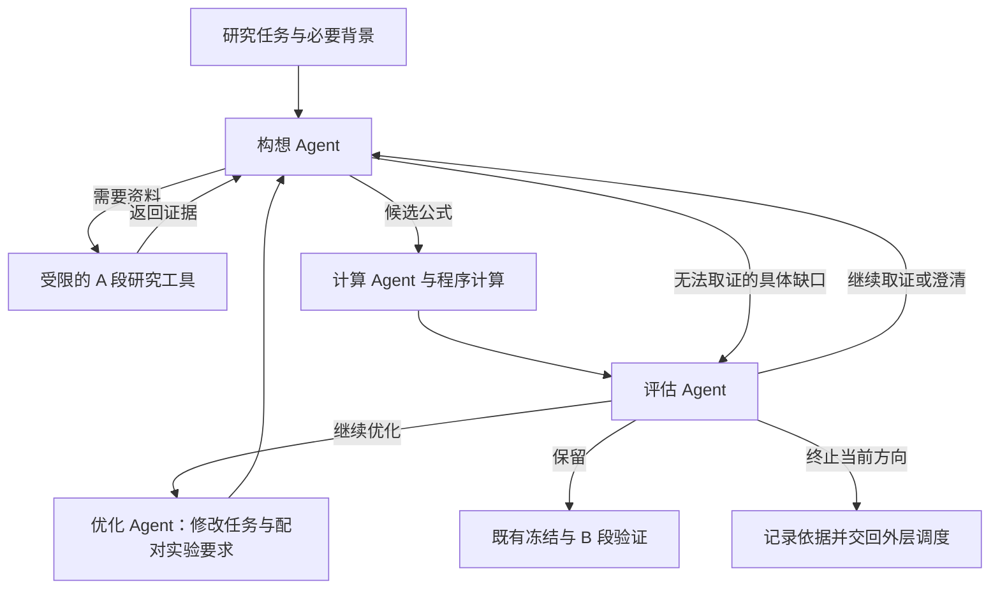

# 构想 Agent 信息获取循环改造 Plan

- 日期：2026-10-11
- 状态：实现及本地验收完成；原生模型生成与长期挖掘效果尚未实测。
- 授权依据：用户确认本会话流程图，并要求按该流程改造构想 Agent、先写 Plan 再由子 Agent 实施。
- 工作位置：现有 `codex/factor-mining-next` 工作树；保留本次开始前的全部用户修改。

## 1. 目标与问题依据

让构想 Agent 在同一研究任务内反复执行“判断所需信息 → 检索或读取 A 段证据 → 继续构想”，并输出候选公式或事实性的资料缺口。构想 Agent 不决定保留、淘汰、暂停或终止研究方向。

本次使用 4h 第 334 轮作为已知问题样本：初始请求包含 334 条任务，333 轮研究结果及图谱明细以分页引用提供；模型表示资料不足，却没有请求补读，直接返回空候选。当前程序已有 `read_records` 应用层循环，但 Codex 适配层每次创建临时线程，禁用原生工具并拒绝上下文压缩。

另一个必须同时处理的职责差异：当前代码由优化 Agent 决定候选去向，评估 Agent 只解释。用户本次已明确将研究去向决策交给评估 Agent，新实现必须真正落实该归属。

## 2. 用户确认的流程

- 构想 Agent：取证、理解历史、提出公式；只能报告资料缺口，不能自行终止方向。
- 计算 Agent：核对公式含义、执行已有计算流程。
- 评估 Agent：根据 A 证据决定保留、继续研究、暂停或终止；空候选必须进入评估，不能由空数组直接自然结束研究。
- 优化 Agent：仅对评估授权继续的候选提出语义修改与预声明配对实验，不改写候选去向，不直接生成最终公式。
- 程序：继续负责数值指标、配对路线状态、B 准入和最终质量验收；模型不能覆盖这些数值判定。

## 3. 本次范围

### 3.1 构想阶段的原生工具循环

复用当前 Codex Python SDK / app-server 接入，不迁移到云端 Agents API，不新增模型供应商或改变模型配置。

为构想阶段增加原生工具调用入口；一次构想调用内允许多次工具调用、接收结果和上下文压缩，再返回最终结构化结果。各研究任务、角色及 A/B 段继续隔离，不复用包含 B 结果的会话。

已核实本机 SDK 0.154.0 的同步 `CodexClient` 可以通过服务器请求回调处理 `item/tool/call`，`thread/start` 接受原生 `dynamicTools`，`turn/start` 支持 `outputSchema`。构想阶段采用该接法，实验接口仅在这一进程配置中启用，不升级依赖或另建 MCP 服务。超时与取消保持当前调用契约。

传输入口为 `CodexModel.complete_with_tools`，接收工具定义、只读处理函数及最终输出格式。原生工具调用负责取证；最终仍返回 `{result, read_records: []}`，以复用领域结果校验和归档。原生最终回复不得再触发应用层 `read_records` 回退。

其他现存供应商和离线测试模型仍保留原有调用契约；原生 Codex 接口失败时应明确失败，不能悄悄退回一次性生成。

### 3.2 信息工具与初始上下文

工具限于当前角色获准读取的 A 证据：

1. 检索历史研究与候选，返回短摘要、记录 ID 和可读取位置。
2. 根据记录 ID、候选引用或 JSON 路径读取公式、A 结果、失败原因和图谱明细。
3. 保留现有分页能力；大表只返回所请求的页，读取范围与出处可查。

初始上下文只提供研究合同、当前任务、当前优化提案、字段/算子说明及本轮图谱引用。历史紧凑索引保留在工具端，由检索工具按需返回。已明确指定的父因子和任务引用证据，加载必要的公式与数值摘要；其余历史按需检索。不得再次全量附带数百条 task/reason。

资料读取的权限由程序校验，不能只依靠提示词。继续禁止 B/C 证据进入构想、任意文件系统访问、外部网络工具、个人记忆和无关插件。原始结果保持原值；摘要不替代公式和数值事实。

### 3.3 决策权限与空候选处理

将 A 段候选去向及当前轮是否继续的决策移交评估 Agent。优化 Agent 只消费评估授权并提出修改任务。

每轮评估保存 `round-NNN-review`（`research_review`），明确记录本轮动作、逐候选决定和必要的补证任务。后续构想通过 `evaluator_review_ref` 读取补证要求。外层 Goal 继续按现有规则选择研究任务，但这项任务判断由评估角色承担；Goal 是否达成仍由程序验证。

构想的空候选或资料缺口交给评估 Agent 判断下一步，不能被视为构想 Agent 的停止命令；也不强制模型为了填满列表而制造公式。程序异常、证据访问越界和运行超时作为运行问题明确报告，不伪装成研究结论。

保留实际需要的历史记录读取：旧归档中的优化决策仍可以作为旧证据被读取，新运行的决策来源必须明确归属于评估 Agent。不得回写历史实验或将旧记录标成新流程的执行结果。

## 4. 不在本次范围

- 不重启六组挖掘、暂停的 Goal 或自动巡检；不续跑历史恢复目录。
- 不改公式语法、收益标签、IC 门槛、HAC/FDR、质量目标、A/B/C 时间边界或市场数据。
- 不改全局 Codex 设置、登录状态、模型名称、推理档位或服务档位。
- 不重新加入哈希校验机制或给用户输出添加哈希元数据。
- 不清理无关文件、不提交或推送 Git、不发布或部署。

## 5. 实施分工与顺序

1. 主 Agent 写入本 Plan，核对已有变更，并保留修改前差异以便最终审查。
2. 子 Agent 核实本机 Codex 原生工具协议、当前决策职责和需要保留的历史读取契约。
3. 子 Agent 实施 Codex 工具循环及证据检索接口；按明确文件分工避免同时修改同一文件。
4. 子 Agent 实施评估/优化权限调整、流程衔接和对应测试。
5. 主 Agent 整合、检查实际任务差异；测试子 Agent 运行相关离线验证；根据真实失败修复。
6. 更新模块说明及本 Plan 的完成状态，交付验证结果与尚未验证的范围。

## 6. 验收标准

- [x] 原生 Codex 构想调用可以在一个任务会话内连续读取两次不同证据，随后返回结构化结果（离线协议验证）。
- [x] 工具入口只能读取获准的 A 记录；越界、B/C、任意路径请求被拒绝。
- [x] 上下文压缩事件能被正常处理，不能导致工具能力或研究边界被悄悄改变（离线协议验证）。
- [x] 使用第 334 轮的只读资料，初始上下文不再包含 334 条完整任务；父因子/相关证据可被准确获取。
- [x] 构想空候选会交给评估 Agent；评估可要求继续取证，也可基于依据结束当前方向；构想自身没有终止权限。
- [x] 候选的保留/优化/暂停/淘汰由评估 Agent 发出；优化 Agent 不能越过该授权或改变决定。
- [x] 因子计算、冻结、B 验证、角色模型路由及既有历史读取所需契约通过相关回归检查。
- [x] 原始第 334 轮记录、历史实验、现有市场数据及本次开始前的用户修改均未被覆盖。
- [x] 完成任务差异审查，没有为假想场景加入默认值、回退、额外配置或无依据的重试。

验证以本地离线协议测试、受控工具调用测试和研究流程测试为主。第 334 轮仅作为只读回放材料；真实模型质量提升与长期挖掘效果不由离线通过推定。

## 7. 官方接口依据

- [Codex as a platform](https://developers.openai.com/blog/codex-as-a-platform)：复用 Agent loop，由应用提供业务上下文、工具和规则。
- [Codex App Server](https://learn.chatgpt.com/docs/app-server)：会话、原生工具回调、流式事件和压缩接口。
- [Compaction](https://developers.openai.com/api/docs/guides/compaction)：上下文压缩与后续状态接续。

## 8. 执行记录

- 已确认工作树已有用户改动，相关差异已独立保留用于对照；不回滚这些改动。
- 修改前相关离线测试：159 passed，0 failed，约 99 秒。
- 三个实施子 Agent 分别负责：Codex 传输与模型路由；只读研究工具、构想上下文与网关；评估/优化权限、工作流和既有测试。
- Goal 历史通过 `history_index`、`allowed_history_record_ids` 和 `history_reader` 接入；恢复时重新注入获准的 A-only 读取器，不序列化回调或暴露任意路径。
- 已实现 `search_a_evidence` / `read_a_evidence`，保留当前 A 记录和历史 A 记录的独立白名单。历史访问覆盖 A cycle、task、经来源核验的输入目录及已存在的任务选择诊断；旧 Optimizer 诊断仍按原来源可读。
- 新评估记录保存候选决定、报告与补证请求；旧检查点复用原决定和停止原因。A 报告逐项标注新评估决定或旧 Optimizer 决定，未回写历史实验。
- 合并回归覆盖 `tests/test_factor*.py`、`test_codex_model.py`、`test_agent_runtime.py`、`test_structured_output.py`、`test_multifactor_factors.py`，最终共 **302 个唯一测试通过**（合并运行加修复后的定向复测，重跑不重复计数；另有 252 个子检查通过）。最终文件集经 `--collect-only` 确认数量。旧请求结构及夹具完成迁移后，失败项和受影响模块均已复测通过；恢复测试继续验证数值复用、冻结前报告齐备和 B 隔离。
- 真实 SDK 握手在 bundled runtime `0.154.0` 与本机应用 runtime `0.162.0-alpha.17.2` 均通过：初始化实验接口、读取订阅状态、创建带两个动态工具的临时只读线程、关闭。未调用 `turn_start` 或启动模型生成。
- 第 334 轮只读重建：初始请求的保守字节上界由 **687,830** 降至 **97,491**，下降约 **85.8%**。该数值包含消息、工具定义和输出 schema 的序列化开销，不是实测模型 token 或费用。5 个相关 cycle 预载的 11 个候选摘要指针、30 个逐币目录指针均核对可读且与原值一致；`inputs-00001010` 未被误报为已预载，可通过历史工具单独读取。
- 字节复测来源：[第 334 轮原始请求](../../experiments/factor_mining/quality_comparison_20261004/six-arms-125251/arms/all-luna-4h/goals/fm-v6-quality-all-luna-4h-20261004-125251/runs/goal-390db63370a1-000334/model_calls/00001-request.json)。当前上界为 `sum(UTF8(message.content)字节数 + 32) + 128 + UTF8(dumps(tools))字节数 + UTF8(dumps(output_schema))字节数 + 64`。
- 最终审查修复了超预算二次压缩恢复大目录的问题，并移除了重复历史上下文读取与重复期限证据校验实现。工具测试验证超预算压缩不恢复大对象、不丢父因子预载、预算不足时不调用模型。
- 本次未重启挖掘、恢复历史 Goal、提交或推送代码；真实生成中的自主取证效果与长期研究产出留待后续实际运行验证。
